# Wled_Console_s3

<p align="center">
  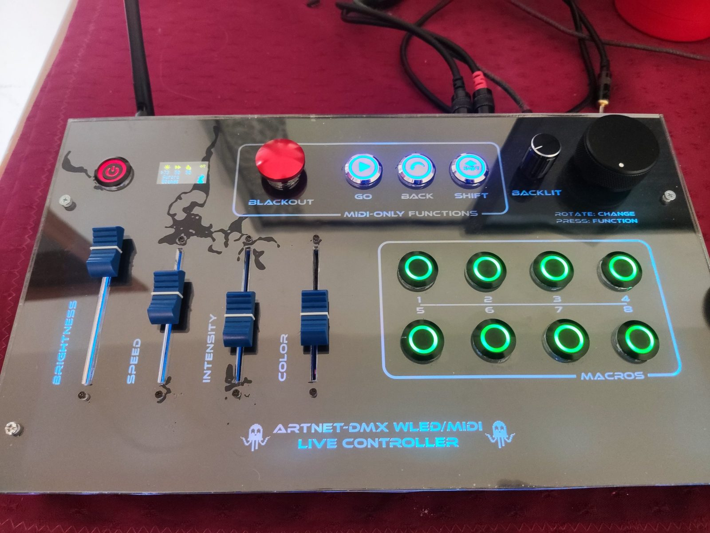
</p>

A standalone lighting console built on [WLED](https://github.com/wled/WLED) for the ESP32-S3 (ESP32-S3-WROOM-1 N16R8).
It runs without a computer, driven by hardware controls, and becomes a USB MIDI controller and a DMX-USB interface
when connected to a PC.

**Strengths**

- **Standalone WLED console:** four touch-activated faders (brightness, speed, intensity, color), so a fader never overwrites
  changes made from the web UI or presets until you move it. With SHIFT held, the color fader selects the palette.
- **Fast control:** eight macro buttons, a BLACKOUT button, a SHIFT layer for eight more presets, and BACK / GO to step through presets.
- **Audio-reactive:** line-in audio (PCM1808 on I2S) drives WLED's audio-reactive effects.
- **DMX in/out:** a non-blocking DMX output driver and a DMX input, both on RS485.
- **OLED and rotary encoder:** local display and encoder navigation, with the network info screen on demand.
- **USB MIDI and DMX console:** when a PC is connected, faders, buttons and encoder are sent as USB MIDI, and the COM port acts as an
  ENTTEC DMX USB Pro interface, usable with any program that speaks that protocol.
- **Networking:** WiFi, plus optional wired Ethernet with a W5500 module.
- **Reproducible and open:** small patches to stock WLED, documented step by step, EUPL-1.2 licensed.

This repository is **not** a WLED fork. It holds only what is added to, or patched into, a WLED checkout, laid out like the
WLED source tree: custom usermods (`usermods/console_*`), a few core files, three small patches
(`dmx_patch/`, `alt_patch/`, `eth_patch/`) and `platformio_override.ini` with the build environments.

Tested on wled/WLED `main` commit `20e7a71` (2026-10-25), arduino-esp32 3.3.8.

## Prebuilt firmware

No build needed: flashable binaries for the WiFi version (`console_s3`) are on the
**[Releases page](https://github.com/bob45ultras/Wled_Console_s3/releases)**. First flash on an ESP32-S3-WROOM-1 N16R8, through the
devkit's UART port:

```
esptool --chip esp32s3 --port COM5 --baud 460800 write-flash 0x0 Wled_Console_s3-v0.1.0-console_s3-factory.bin
```

- `...-factory.bin` is the full image (bootloader, partitions, firmware) and goes at `0x0` with esptool or a flasher. Never upload it through WLED's OTA page.
- `...-ota.bin` is for updates of a console that already runs this firmware (WLED: Config → Security & Updates → Manual OTA).
- No Ethernet build is published yet. Check `SHA256SUMS.txt` against the downloads. Details: [CONSOLE_README.md, section 3](CONSOLE_README.md#3-installation).

To build from source, use the Quick start below.

## Quick start

```powershell
git clone https://github.com/wled/WLED.git WLED-main
git -C WLED-main checkout 20e7a71
git clone https://github.com/bob45ultras/Wled_Console_s3.git
robocopy Wled_Console_s3 WLED-main /E /XD .git docs /XF README.md LICENSE
cd WLED-main
git apply --ignore-whitespace dmx_patch\patch_core_dmx.diff
git apply --ignore-whitespace alt_patch\patch_alt.diff
pio run -e console_s3 -t upload
```

Add `git apply --ignore-whitespace eth_patch\patch_core_eth.diff` and build `console_s3_eth` only for the W5500 Ethernet version.

Everything else (wiring, settings, MIDI map, DMX, troubleshooting, status) is in **[CONSOLE_README.md](CONSOLE_README.md)**.

## Status

Verified on hardware: faders (including SHIFT + color fader = palette), standalone buttons, USB MIDI (faders, buttons, encoder),
OLED "MIDI-USB" screen, ENTTEC bridge (PC test script), line-in audio. Pending: DMX on real equipment, W5500 with a working
module, battery/power stage.

## Gallery

**The console**

<table>
<tr>
<td width="50%">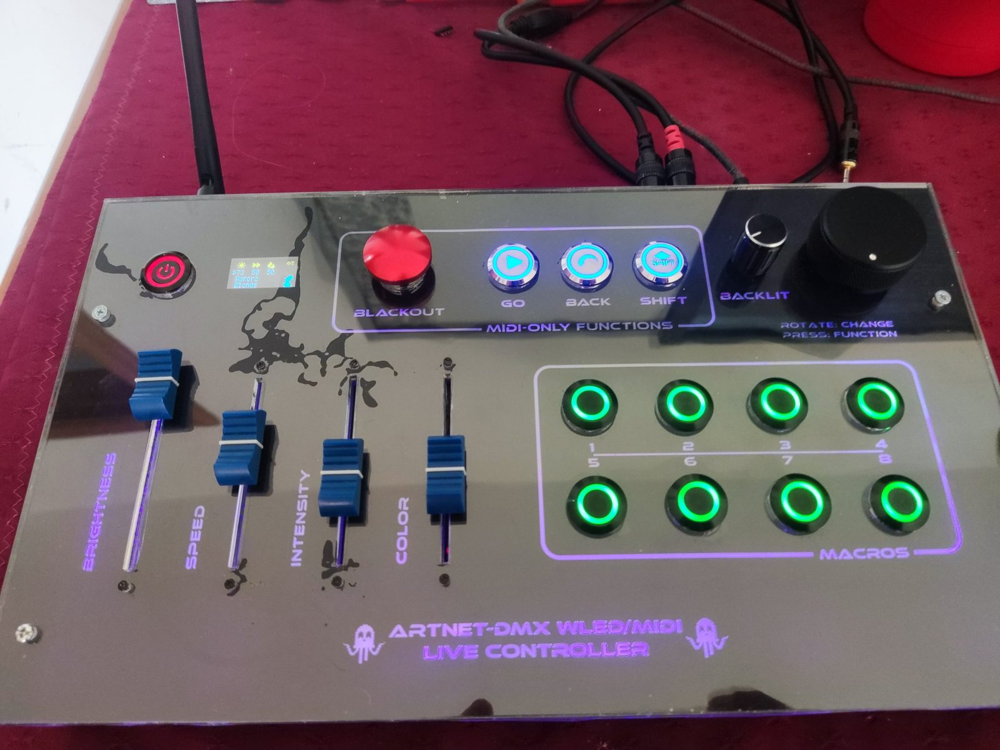<br><sub>Front panel, purple backlight.</sub></td>
<td width="50%">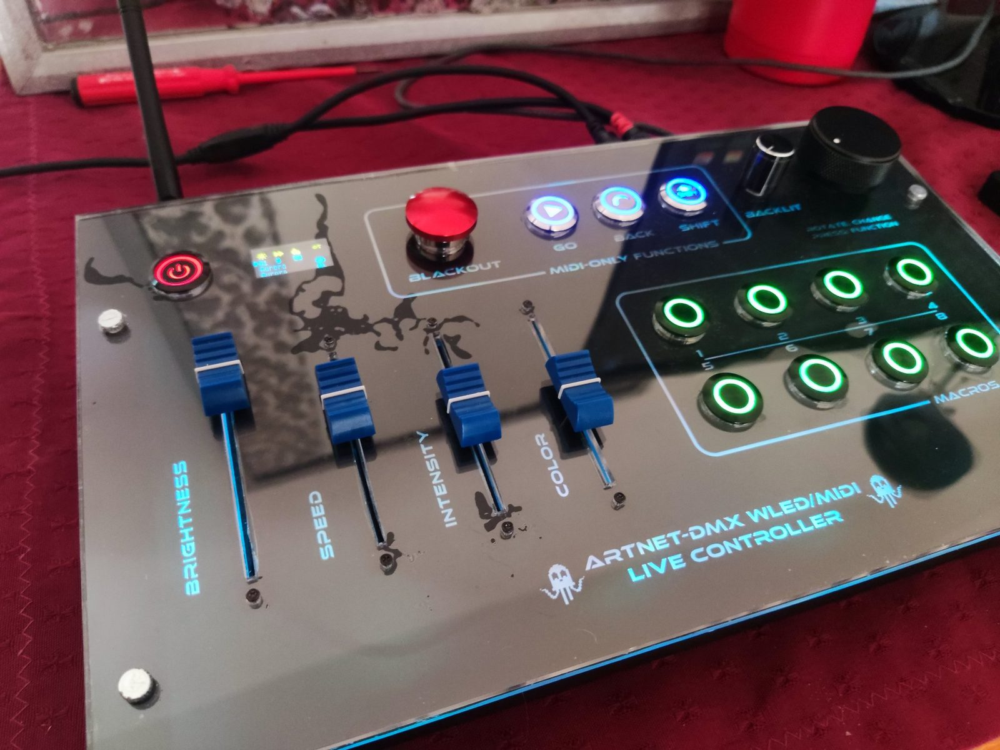<br><sub>Angled view, cyan backlight.</sub></td>
</tr>
<tr>
<td width="50%">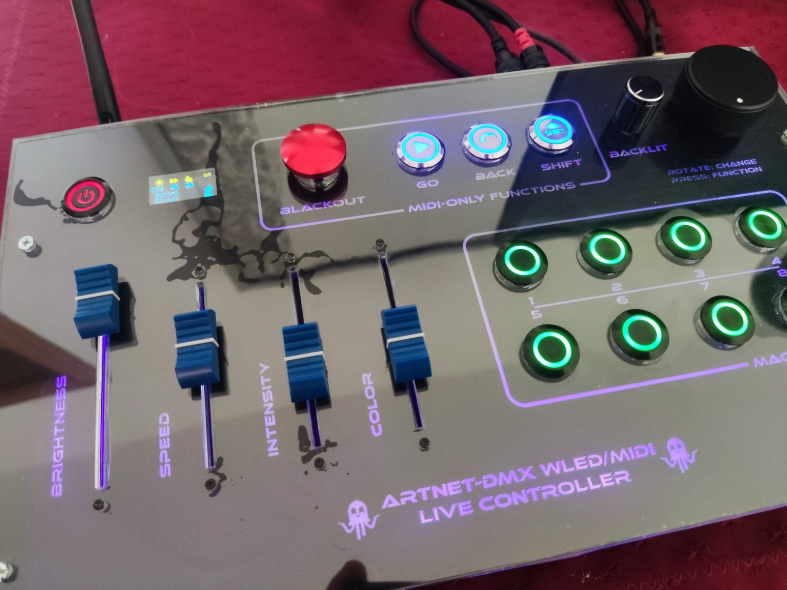<br><sub>Angled view, purple backlight.</sub></td>
<td width="50%">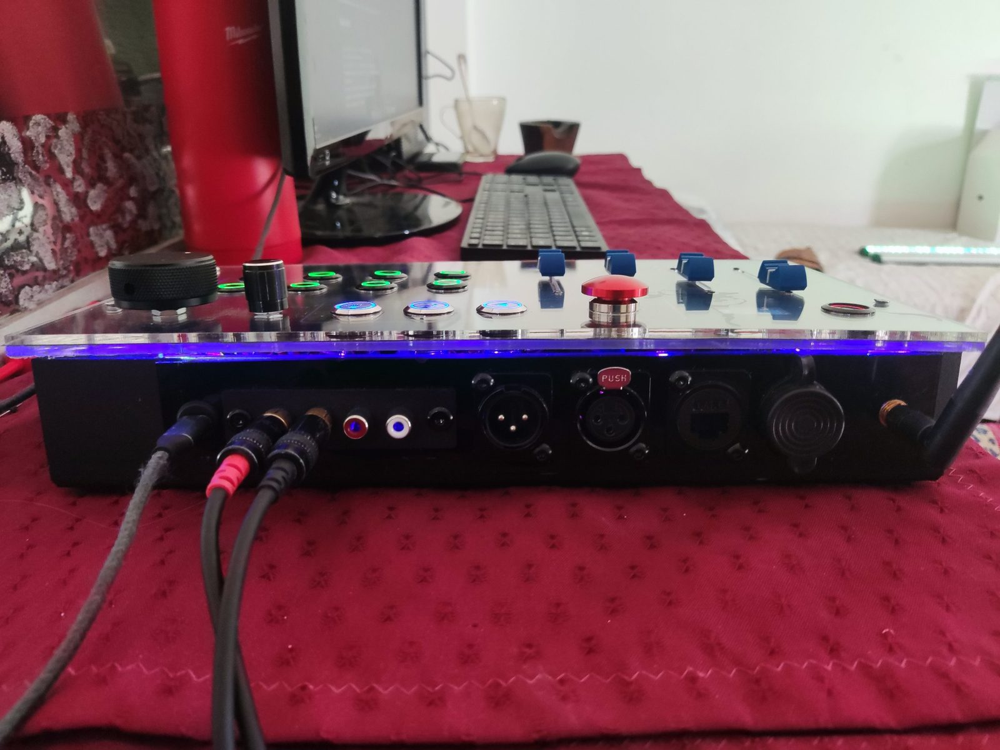<br><sub>Rear panel: USB-C, audio inputs and outputs, XLR DMX connectors, Ethernet, WiFi antenna and UART port.</sub></td>
</tr>
</table>

**Controls and display**

<table>
<tr>
<td width="50%">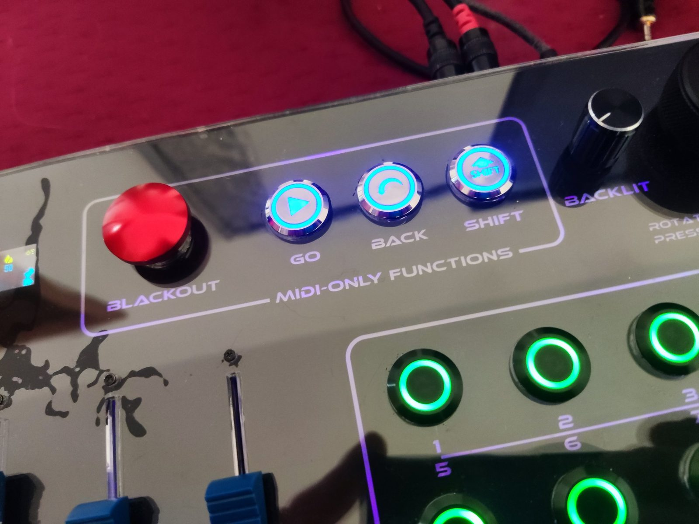<br><sub>BLACKOUT, GO, BACK and SHIFT buttons.</sub></td>
<td width="50%">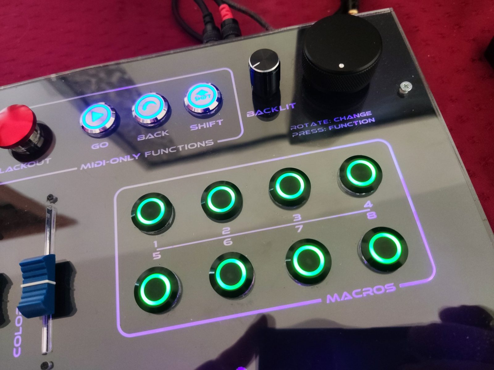<br><sub>Eight macro buttons and the rotary encoder.</sub></td>
</tr>
<tr>
<td width="50%">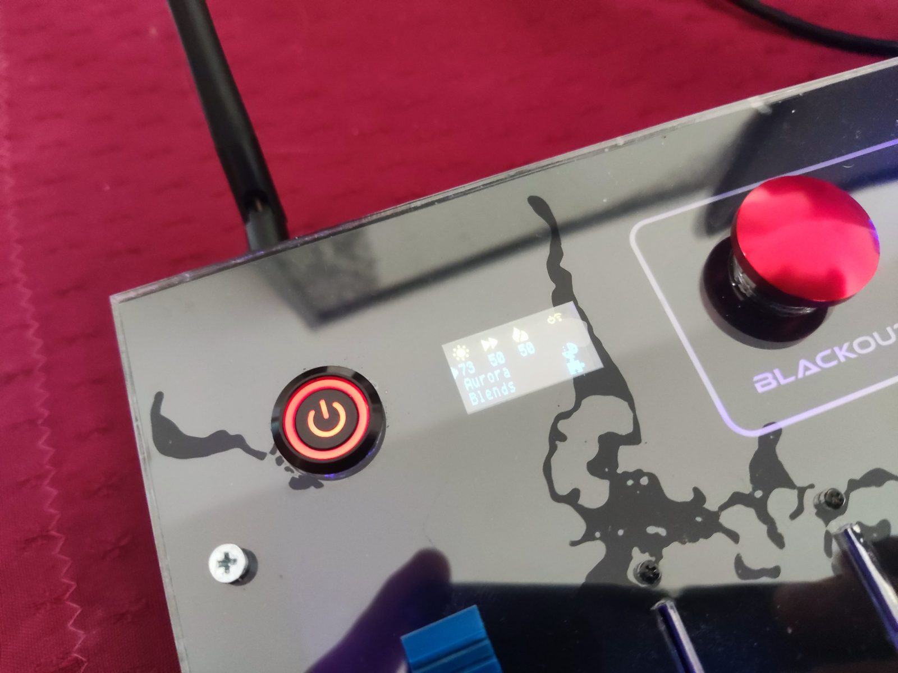<br><sub>Power button, OLED and BLACKOUT button.</sub></td>
<td width="50%">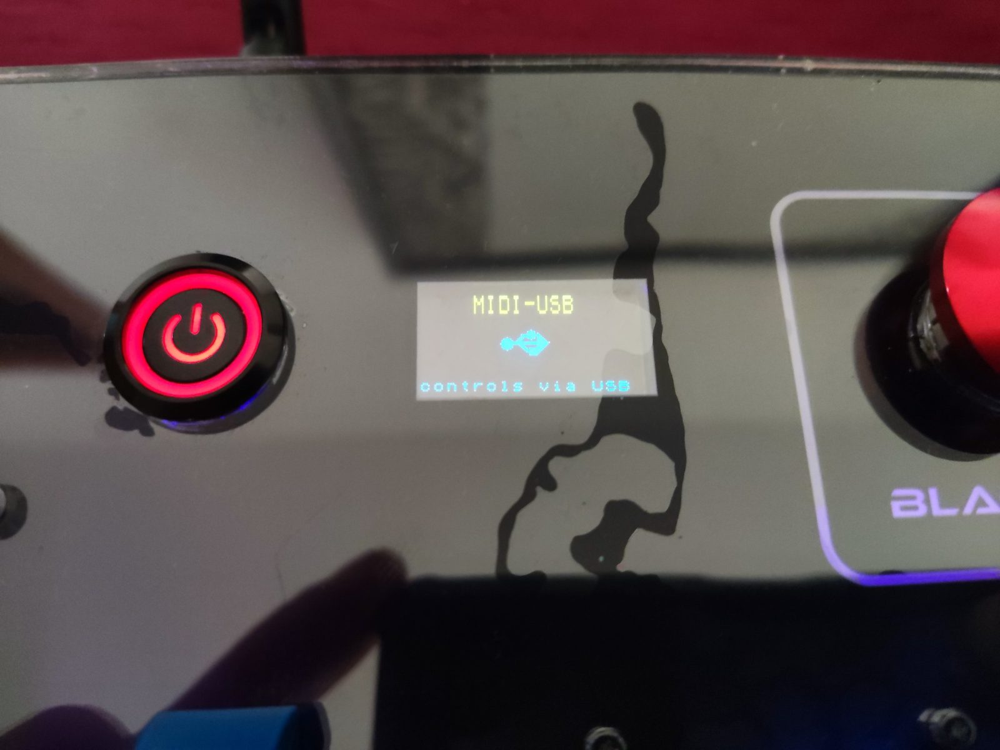<br><sub>OLED in USB mode: "MIDI-USB, controls via USB".</sub></td>
</tr>
<tr>
<td width="50%" colspan="2" align="center">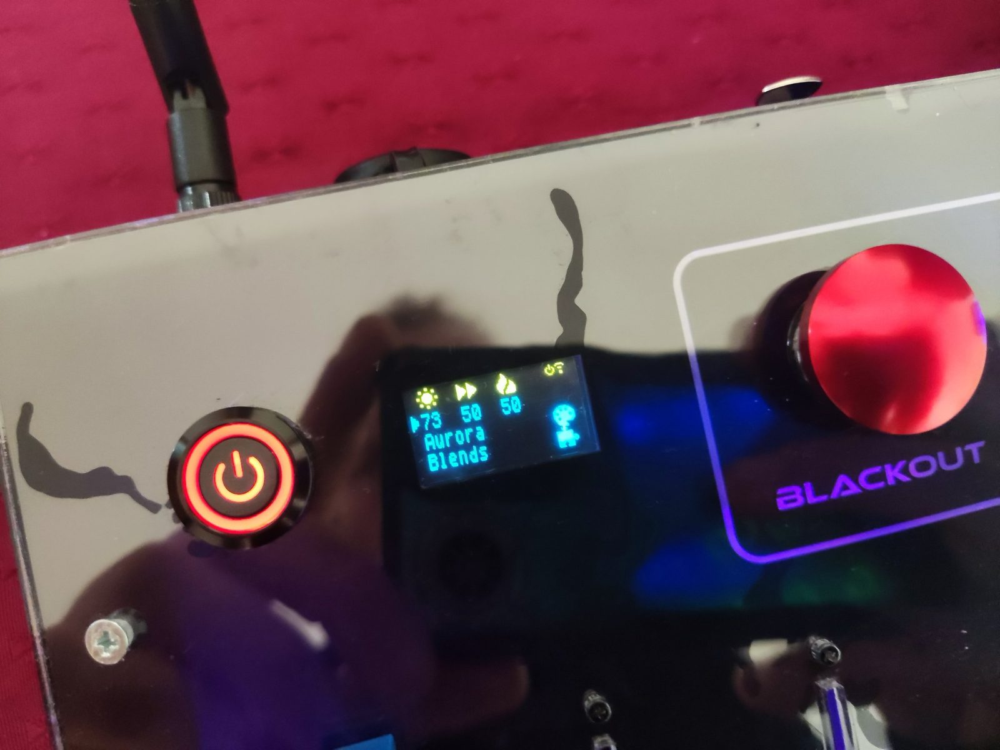<br><sub>OLED: WLED status screen.</sub></td>
</tr>
</table>

**Construction**

<table>
<tr>
<td width="50%">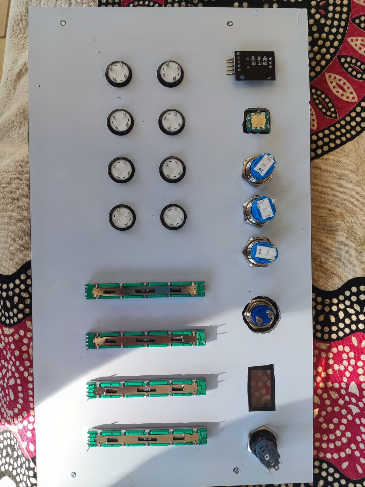<br><sub>Control plate with faders, buttons and rotary encoder mounted, before wiring.</sub></td>
<td width="50%">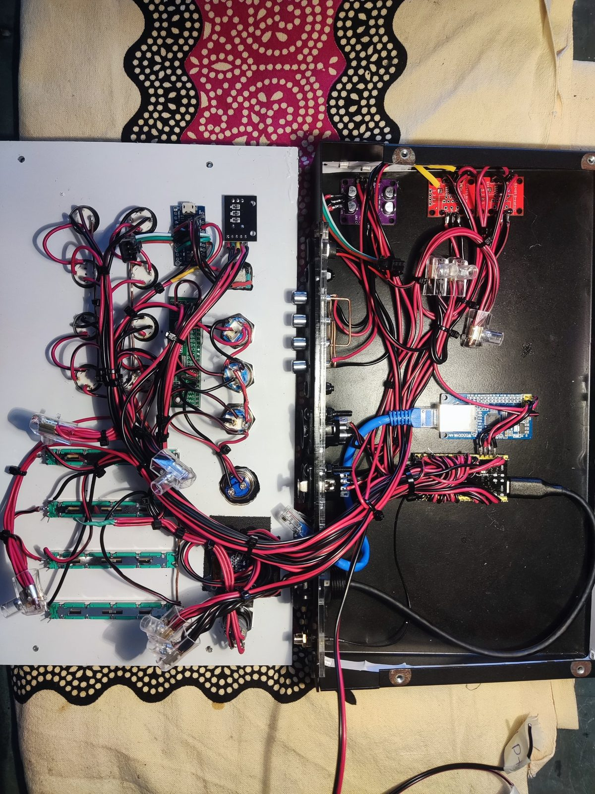<br><sub>Wired control plate (left) and electronics bay (right) with the ESP32-S3 board and the W5500 Ethernet module.</sub></td>
</tr>
</table>

## License

Copyright (c) 2026 [E-Boats Systems](https://www.eboatsystems.com), licensed under the [EUPL v. 1.2](LICENSE) (the same licence as WLED). Parts derived from
WLED and third-party components are listed in [NOTICE](NOTICE). Short summary: [CONSOLE_README.md](CONSOLE_README.md#15-license).
